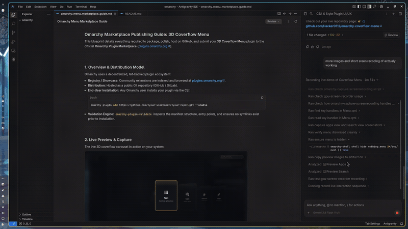
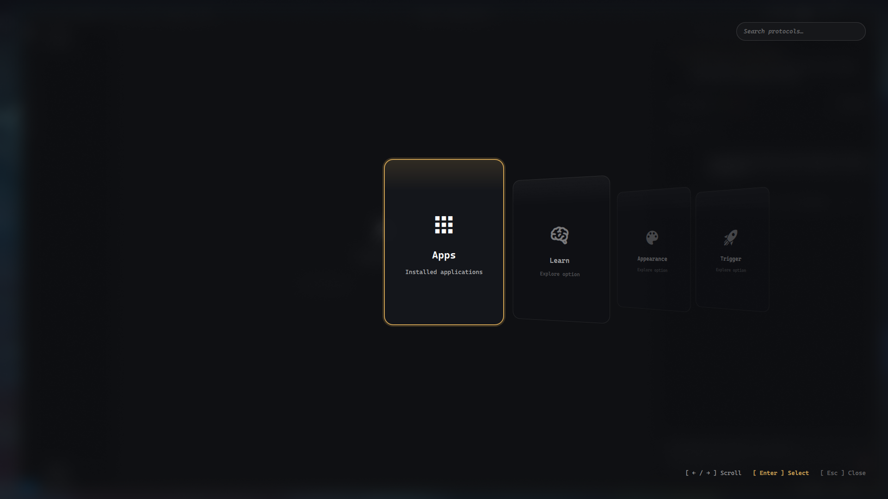
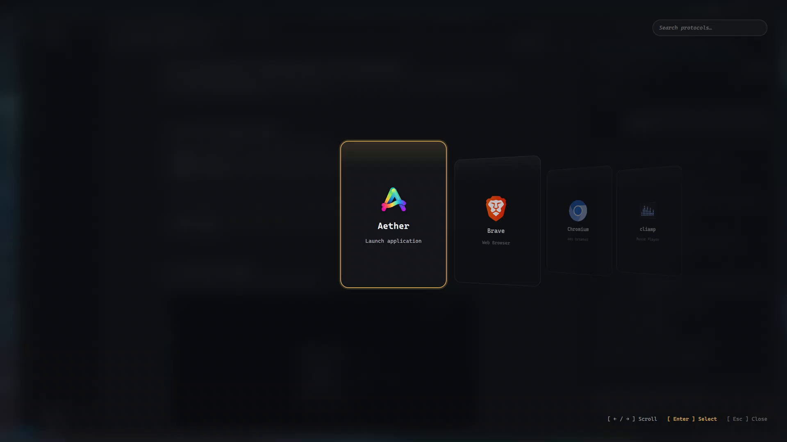
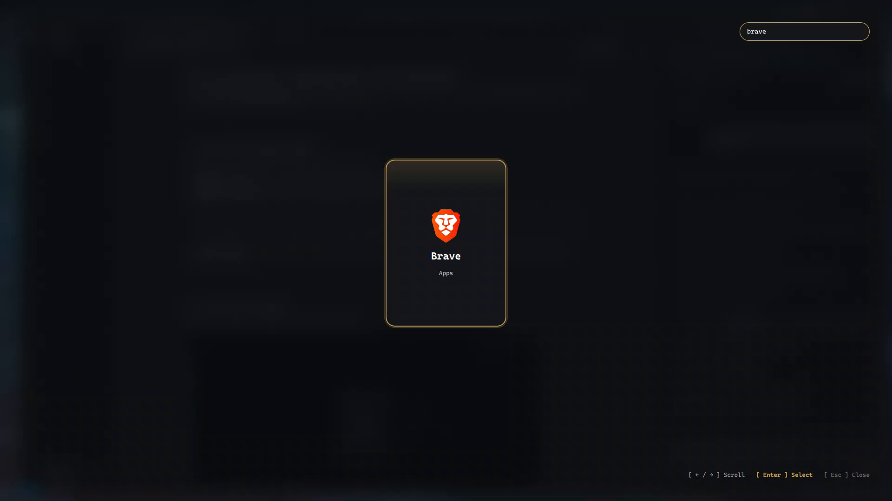

<div align="center">

# 🎴 Coverflow Menu
### Cinematic 3D Application Launcher & Command Hub for Omarchy

[](https://plugins.omarchy.org)
[](https://quickshell.outfoxxed.me/)
[](LICENSE)
[](https://hyprland.org)

<br/>

<p align="center">
  
</p>

*A fluid, 3D perspective application launcher built with smoked obsidian glass aesthetics, glowing champagne gold highlights, instant fuzzy search, and smooth motion.*

---

</div>

## ✨ Highlights

* **🎠 3D Perspective Carousel**
  * True 3D perspective card rotation and scaling that glides across your installed apps.
  * Responsive to mouse-drag, trackpad gestures, scroll-wheel, and keyboard navigation.

* **⚡ Instant Keystroke Search**
  * High-speed fuzzy search matching application names, binary names, and keywords.
  * Launch apps in milliseconds without leaving the keyboard.

* **🗂️ Smart Category Filtering**
  * Seamless categorization: Development, Internet, Multimedia, Graphics, Office, and System Utilities.
  * Intelligent sorting keeps frequently opened apps right at your fingertips.

* **💎 Smoked Glass Aesthetic**
  * Crafted with deep dark smoked glass, warm gold accent borders, and clean typography designed to elevate your desktop workflow.

* **🧩 Dual Plugin Entry Points**
  * **Overlay Launcher (`menu`)**: Fullscreen, keyboard-navigable 3D command center.
  * **Top Bar Trigger (`barWidget`)**: Minimal, high-aesthetic icon that docks directly into your Omarchy panel.

---

## 📸 Visual Gallery

<div align="center">

| Root Category Hub | Applications Carousel |
| :---: | :---: |
|  |  |

| Instant Fuzzy Search |
| :---: |
|  |

</div>

---

## 📦 Installation

Install directly into your Omarchy desktop using the official plugin CLI:

```bash
omarchy plugin add https://github.com/HackerO112/omarchy-coverflow-menu.git --enable
```

*The shell will validate the manifest and register the plugin automatically.*

---

## 🎮 Keyboard Controls

| Keybinding | Scope | Action |
| :--- | :--- | :--- |
| <kbd>Super</kbd> / <kbd>Meta</kbd> | Global | Toggle 3D Coverflow Launcher |
| <kbd>←</kbd> / <kbd>→</kbd> | Carousel | Navigate through cards in 3D perspective |
| <kbd>Enter</kbd> / <kbd>Return</kbd> | Active Card | Launch selected application or open category |
| Any Keystroke | Menu | Instantly focus and filter via fuzzy search |
| <kbd>Backspace</kbd> | Search / Menu | Erase query or go back to parent view |
| <kbd>Esc</kbd> | Menu | Dismiss launcher |

---

## 🛠️ Architecture

Built completely native for **Omarchy** and **Quickshell**:
* **`manifest.json`**: Official schema-validated metadata declaring `menu` and `bar-widget` entry points.
* **`Menu.qml`**: GPU-accelerated QML rendering engine handling dynamic 3D card projections, depth scaling, and smooth spring physics.
* **`MenuModel.js`**: Lightweight, asynchronous XDG `.desktop` entry scanner and fuzzy-matching engine with zero external binary dependencies.
* **`BarWidget.qml`**: Lightweight top bar launcher module with quick toggle bindings.

---

## 🔄 Updating & Removal

To pull the latest updates:

```bash
omarchy plugin update nothing.menu
```

To remove the plugin:

```bash
omarchy plugin remove nothing.menu
```

---

<div align="center">

Crafted with care for the **Omarchy** community.

**[Browse on Omarchy Marketplace](https://plugins.omarchy.org)**

</div>
